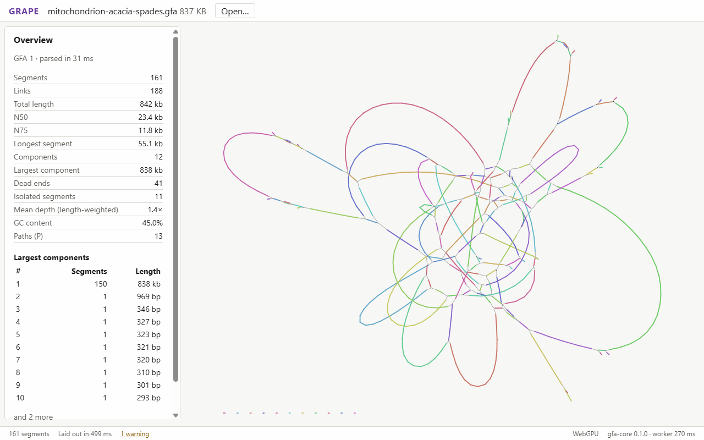
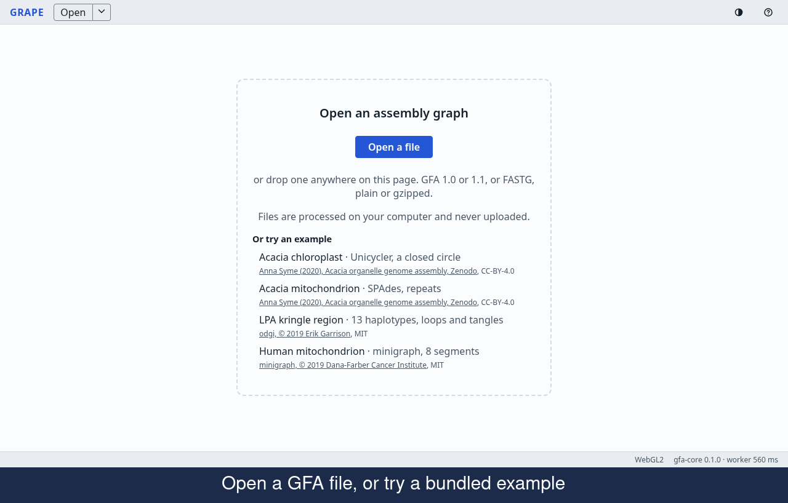

<p align="center">
  
</p>

[](https://github.com/Vikmanou/GRAPE/actions/workflows/ci.yml)

**GRAPE** (GPU-Rendered Assembly Path Explorer) is a browser viewer for genome
assembly graphs. Drop a GFA file on the page and see it laid out and drawn on the GPU.
Nothing is installed and nothing is uploaded: parsing, layout and rendering
all run on your machine.



<sub>Acacia mitochondrion assembled by SPAdes, with three of its contig paths
highlighted, from [Zenodo 5722622](https://doi.org/10.5281/zenodo.5722622)
(CC-BY-4.0). It is one of the bundled examples under Open, then Examples.</sub>



## Features

- GFA 1.0 and 1.1 and SPAdes-style FASTG, plain, gzipped or bgzipped, up to
  1 million segments and 1.5 million links. Larger graphs still load, with a
  warning.
- Graph stats, a sortable table of components (length, mean depth, whether
  it closes into a circle) and parse warnings with line numbers.
- Four bundled example graphs under Open, then Examples.
- Segments drawn as ribbons and links as curves, in Bandage's style.
- Multilevel force-directed layout on the GPU that you watch settle, with
  pause, resume, a seed you can set (the same seed gives the same layout) and
  Fast, Balanced and Best presets. A 200k-segment graph settles in under a
  minute on integrated graphics; see [bench/results.md](bench/results.md).
- Colour by depth (linear or log, adjustable range), GC, length, component,
  path, Bandage's CL/C2 tags or at random, with legends; width by depth;
  labels that never overlap; Bandage's double mode with both strands; light
  and dark themes.
- Paths (P) and walks (W): search them, highlight several in their own
  colours and step through one segment by segment.
- Filters that hide without a new layout: within N steps of the selection,
  only the selected components, components under a size, a depth range.
- Merge simple chains as Bandage's "Merge all possible nodes" does, and save
  the merged graph as GFA in Bandage's format.
- Graphs saved without sequences (ABySS style) take them from a FASTA file.
- Find DNA in the graph: paste bases or give a FASTA file, and hits show as
  bands on the ribbons and in a table, joined across linked segments.
- Drag to pan, scroll or pinch to zoom, arrow keys and +/-, F to fit.
- Click a segment to see its length, depth, GC, component, neighbours, its
  line in the file and the ends of its sequence; shift-click to add or
  remove, shift-drag to select by box, select whole components, invert and
  zoom to the selection.
- Copy sequences or save them as FASTA exactly as Bandage writes them.
- Export the view as a PNG up to 4× the screen (tiled past the GPU's
  texture limit) or as SVG; save GFA or FASTA of the whole graph, the
  selection or what the filters show.
- Share a link that carries the whole graph and the view (layout seed,
  settings, camera, selection, highlighted paths), packed in the browser by
  a DNA-aware coder (about 1.7 to 1.9 bits per base), so it opens with
  nothing else to download. Graphs up to roughly 7 million bases of distinct sequence
  fit Chrome's 2 MB link limit; past 1 MB, Firefox opens the link when it is
  pasted into Open URL.
- Export and load layouts as BandageNG does (`.layout`, and `.tsv` with one
  point per segment), so a drawing moves between GRAPE and BandageNG and
  comes back exactly in GRAPE on either renderer.
- Open a graph from a URL; your browser downloads it directly.
- Find segments by a list of names or a regular expression.
- Drag a segment to pin it while the rest of the graph follows; unpin, or lay
  out just the selection again.
- Works offline after one visit: the browser keeps a copy of the app.
- Keyboard shortcuts for all of the above; press `?` for the list.

GRAPE draws with WebGPU where the browser has it (current desktop Chrome and
Edge, Safari 26, Firefox on Windows) and with WebGL2 everywhere else, with the
same features: Chrome 56, Edge 79, Firefox 51, Safari 15 or later. Try it at
[vikmanou.github.io/GRAPE](https://vikmanou.github.io/GRAPE/).

## Benchmarks

Measured with `npm run bench:layout` on 2026-11-16 (AMD Ryzen 9 9950X, an
NVIDIA GeForce RTX 5060, Playwright's Chromium). Times count from opening the
file. The full tables, the per-level profile and the memory of each part of
the page are in [bench/results.md](bench/results.md); pointer and frame
timings are in [bench/interaction.md](bench/interaction.md).

| Graph                            | Parse | First usable | Settled | Tab memory | Zoomed out | Zoomed in |
| -------------------------------- | ----: | -----------: | ------: | ---------: | ---------: | --------: |
| bacterial-spades.gfa             | 0.0 s |        0.5 s |   0.7 s |     190 MB |     60 fps |    60 fps |
| mitochondrion-acacia-spades.gfa  | 0.0 s |        0.6 s |   0.6 s |     194 MB |     60 fps |    60 fps |
| lpa-13-haplotypes.gfa            | 0.0 s |        0.8 s |   0.9 s |     203 MB |     60 fps |    60 fps |
| potato-hifiasm-unitigs-noseq.gfa | 0.1 s |        0.9 s |   1.0 s |     271 MB |     60 fps |    60 fps |
| 200,000 segments (synthetic)     | 0.2 s |        1.3 s |   1.5 s |     388 MB |     60 fps |    60 fps |
| 1,000,000 segments (synthetic)   | 1.2 s |        2.9 s |   5.7 s |    1103 MB |     60 fps |    60 fps |

### Against Bandage and BandageNG

Written by `node scripts/bench-compare.mjs` and `node scripts/compare-table.mjs`.

<!-- compare:start -->

| Measure                                         |                      GRAPE |                   Bandage |                                                          BandageNG |
| ----------------------------------------------- | -------------------------: | ------------------------: | -----------------------------------------------------------------: |
| Open to a laid-out picture, 10k segments (s)    |         1.52 s (1.51–1.53) |        6.13 s (5.97–6.78) |                                             **0.87 s (0.86–0.92)** |
| Open to a laid-out picture, 50k segments (s)    |     **1.51 s (1.48–1.51)** |        32.9 s (31.7–33.6) |                                                 4.86 s (4.71–5.00) |
| Open to a laid-out picture, 200k segments (s)   |     **1.89 s (1.88–1.90)** |     131.7 s (131.1–135.1) |                                                 27.0 s (26.8–28.5) |
| Open to a laid-out picture, 1M segments (s)     |     **7.20 s (7.05–8.84)** |     900.8 s (834.7–998.4) |                                              178.7 s (174.7–187.9) |
| Peak memory at 200k segments (MB)               |       **766 MB (764–770)** |    2,496 MB (2,494–2,497) |                                             2,910 MB (2,910–2,911) |
| Peak memory at 1M segments (MB)                 | **2,003 MB (1,981–2,011)** | 12,666 MB (12,665–12,683) |                                          12,679 MB (11,156–12,687) |
| Largest graph laid out within 30 min (segments) |              **1,000,000** |             **1,000,000** |                                                      **1,000,000** |
| Export a PNG at 200k segments (s)               |         0.03 s (0.03–0.04) |    no layout-only command | within noise (image 27.0 s (26.8–28.5), layout 28.2 s (26.7–28.5)) |

Each value is the median of 5 runs, with the fastest and slowest in brackets;
the lowest value wins each row (the highest for the largest graph) and is in bold, and a
value within 5% of it ties and is bold too. A row marked pending is still missing runs or
mixes machines. "Did not finish" means most runs hit the 30 min cap or failed.

Versions: GRAPE adb35f8 (WebGPU layout, Balanced quality, seed 1, in Playwright's
Chromium headless on the real GPU), Bandage 0.9.0 (Linux AppImage under WSL 2, `--iter 2`, the
default) and BandageNG 2026.11.1 (Windows build, default layout, `--iter 2`). Machine:
AMD Ryzen 9 9950X 16-Core Processor, NVIDIA GeForce RTX 5060, 31 GB, win32 10.0.26200. Runs from 2026-11-17 to 2026-11-17 (UTC).

Open to a laid-out picture: GRAPE from choosing the file to the layout reported done,
timed in the page, with the page already loaded; Bandage and BandageNG the wall time of `image`
at the same size as GRAPE's PNG (1200 by 800), which starts the program, loads, lays out
and draws. Peak memory: GRAPE's renderer plus GPU process, each at its own peak working
set; BandageNG's peak working set; Bandage's maximum resident set from `/usr/bin/time -v`.
PNG export: GRAPE's `exportPng` of the settled view; BandageNG's `image` minus its `layout`;
Bandage 0.9.0 has no layout-only command, so its export cannot be timed apart.

Search by segment name is not compared: neither Bandage tool has it on the command line.
Pan and zoom have no counterpart there either; GRAPE keeps them smooth on the 1M graph
(frame rates in [bench/interaction.md](bench/interaction.md)). The layouts differ (Bandage and
BandageNG lay out on the CPU with OGDF, GRAPE on the GPU), so judge the pictures below.

BandageNG's PNG export is its `image` time minus its `layout` time; at 200k the two overlap run
to run, so drawing the PNG costs less than their noise and gets no time of its own.

The pictures and the GFA comparison are in [docs/benchmarks.md](docs/benchmarks.md).

<!-- compare:end -->

## Development

Requires Rust and Node 22+.

```sh
npm install
npm run dev            # build the WASM core and start Vite
npm run build          # the production build, with the offline worker, in web/dist
npm run check          # the full gate CI runs
npm run check:quick    # Rust and TypeScript checks with unit tests
npm run check:headed   # full gate with browser tests on the real GPU
npm run format         # rustfmt and Prettier
npm run samples        # download real sample graphs (see samples/README.md)
npm run fuzz           # fuzz the parser and the link packer
npm run bench:parse    # time parsing a synthetic 200k-segment graph
npm run bench:layout   # GPU layout timings and quality against the CPU reference
npm run bench:interaction  # frame rates and pointer latency on the 200k and 1M graphs
node scripts/bench-bandage.mjs   # pictures and GFA exports against Bandage and BandageNG
node scripts/bench-compare.mjs   # open time, memory and export against both, resumable
node scripts/compare-table.mjs   # the comparison table from bench/compare.json
```

Native tools for the Rust core, run with
`cargo run -p gfa-core --release --example <name> -- <file>`: `parse_file`
times parsing, `layout_file` times the CPU reference layout (`--svg out.svg`
draws it) and `compare_layout` measures a GPU layout against it.

Design decisions are recorded in [docs/decisions.md](docs/decisions.md). The
browsers and assistive tools the site was checked in are listed in
[docs/browser-checks.md](docs/browser-checks.md). Pushing to `main` publishes the
site to GitHub Pages once the CI gate passes (`.github/workflows/ci.yml`).

## About AI

I use AI coding tools a lot on this project, and I'd rather say so than hide
it. Nothing lands without me reading the code myself and every change passes
the full test gate and is checked by hand on real assembly graphs in the
browser before it's merged. If something is broken anyway, please open an
issue.

## License

[MIT](LICENSE)
