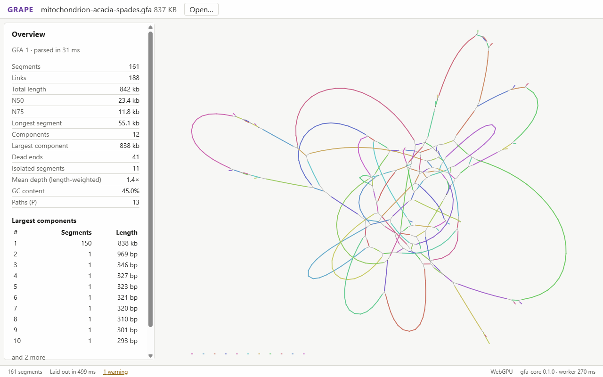

# GRAPE

[](https://github.com/Vikmanou/GRAPE/actions/workflows/ci.yml)

**GPU-Rendered Assembly Path Explorer**: a browser viewer for genome assembly
graphs. Drop a GFA file on the page and see it laid out and drawn on the GPU.
Nothing is installed and nothing is uploaded: parsing, layout and rendering
all run on your machine.



<sub>Acacia mitochondrion assembled by SPAdes, from
[Zenodo 5722622](https://doi.org/10.5281/zenodo.5722622) (CC-BY-4.0).</sub>

## Features

- GFA 1.0 and 1.1 and SPAdes-style FASTG, plain, gzipped or bgzipped.
- Graph stats, components and parse warnings with line numbers.
- Segments drawn as ribbons and links as curves, in Bandage's style.
- Multilevel force-directed layout on the GPU that you watch settle, with
  pause, resume, a seed you can set (the same seed gives the same layout) and
  Fast, Balanced and Best presets. A 200k-segment graph settles in under a
  minute on integrated graphics; see [bench/results.md](bench/results.md).
- Drag to pan, scroll or pinch to zoom, arrow keys and +/-, F to fit.

GRAPE needs WebGPU: current desktop Chrome or Edge.

## Development

Requires Rust and Node 22+.

```sh
npm install
npm run dev            # build the WASM core and start Vite
npm run check          # the full gate CI runs
npm run check:quick    # Rust and TypeScript checks with unit tests
npm run check:headed   # full gate with browser tests on the real GPU
npm run format         # rustfmt and Prettier
npm run samples        # download real sample graphs (see samples/README.md)
npm run fuzz           # fuzz the parser
npm run bench:parse    # time parsing a synthetic 200k-segment graph
npm run bench:layout   # GPU layout timings and quality against the CPU reference
```

Design decisions are recorded in [docs/decisions.md](docs/decisions.md).

## About AI

I use AI coding tools a lot on this project, and I'd rather say so than hide
it. Nothing lands without me reading the code myself and every change passes
the full test gate and is checked by hand on real assembly graphs in the
browser before it's merged. If something is broken anyway, please open an
issue.

## License

[MIT](LICENSE)
